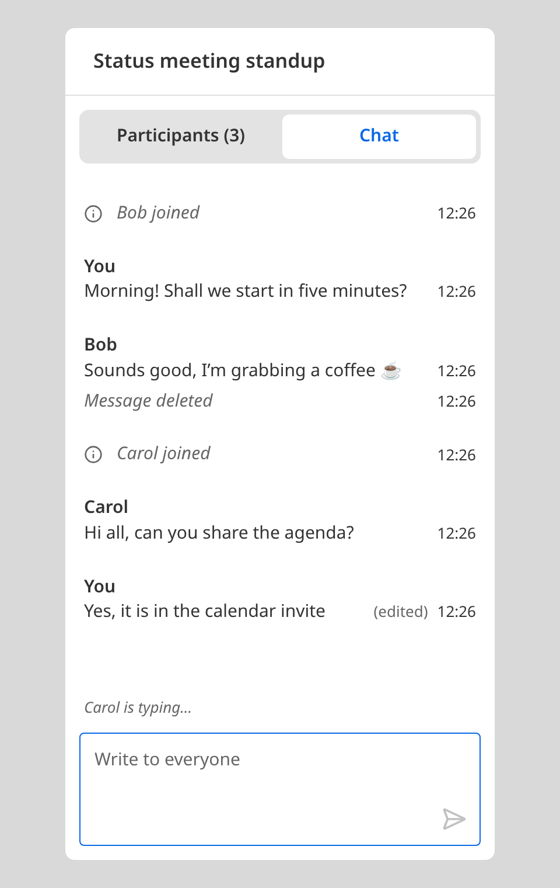

# Ulak

_Ulak_ is Turkish for "messenger", the courier who carried news from town
to town.

A real-time chat for several participants, who talk to each other
directly over WebRTC.



> **How this was built.** The code is AI-generated, written with an AI
> coding agent, but I made the design decisions and steered it. These are
> the main ones and why:
>
> - **Logic in hooks, markup in components.** A screen's state and
>   handlers live in a hook next to it, such as `useChatScreen`, so the UI
>   stays separate from the business code.
> - **CSS modules.** Each component's styles sit next to it and are
>   scoped to it, so class names never clash. Global CSS is only for the
>   reset, colors and spacing.
> - **Husky and lint-staged.** Every commit is formatted, linted and
>   type-checked before it lands, so the history stays clean.
>
> The rules the agent works by are in [`AGENTS.md`](AGENTS.md).

## Running it

You need Node 22.18 or newer, which runs the server's TypeScript
directly, and pnpm.

```sh
pnpm install
pnpm dev
```

`pnpm dev` starts the signaling server on `ws://localhost:8080` and the
client on `http://localhost:5173`. Open the client in two or more windows
to chat. Each tab is its own participant and asks for a name first,
suggesting a random one such as "Guest 4821".

To build the client, run `pnpm build`, then serve the build with
`pnpm preview`. The signaling server still has to run, for example with
`pnpm --filter @ulak/server start`.

The client looks for the signaling server on port 8080 of the host it was
loaded from. To join from another device on your network, start the
client with `pnpm --filter @ulak/client dev --host` and open it at your
machine's address. Set `PORT` to move the signaling server, and
`VITE_SIGNALING_URL` to point the client somewhere else.

Other commands:

- `pnpm test`: unit tests for the client and the server
- `pnpm test:e2e`: end-to-end tests in Chromium. The first run needs
  `pnpm --filter @ulak/client exec playwright install chromium`.
- `pnpm lint`, `pnpm format:check`, `pnpm typecheck`

## Architecture

I chose peer-to-peer (option B). Each client opens a WebRTC DataChannel to
every other client, a full mesh, so chat messages never pass through a
server. The signaling server only tells clients who else is there and
relays their offers, answers and ICE candidates. It holds no chat state,
so it stays about 50 lines.

I picked it because it fits a chat inside a meeting: groups are small, and
a mesh needs no server to relay or store messages. The cost is that every
peer has to keep the shared history itself, which the protocol below
handles.

The client keeps three layers apart, so the core logic runs without a
browser:

- **Protocol and state**
  ([`client/src/protocol`](client/src/protocol),
  [`client/src/chat-state`](client/src/chat-state)): plain TypeScript.
  Event types, a parser that drops malformed input, and a reducer that
  applies events to the chat state.
- **Transport** ([`client/src/transport`](client/src/transport)): the
  WebRTC mesh. It sends and receives parsed events behind a small
  interface and knows nothing about chat state.
- **UI** ([`client/src/screens`](client/src/screens),
  [`client/src/components`](client/src/components)): React.
  `ChatProvider` connects the transport to the reducer, and screens read
  the chat with `useChat()`. Shared components are presentational.

The signaling message types live in the server package, and the client
imports them as
[`@ulak/server/signaling`](server/src/signaling/signaling.ts), so both
sides parse the same types.

## How a session works

1. **Pick a name.** The tab asks for a name and keeps it, with a random
   id, in `sessionStorage`. A reload keeps both and skips this step, and
   the id keeps the right to edit earlier messages.
2. **Meet the others.** The tab connects to the signaling server. The
   server answers `welcome` with the peers already there, and sends
   `peer-joined` to them.
3. **Connect directly.** The newcomer sends an offer to each peer
   through the server, and each answers, so two peers never send offers
   to each other at the same time. ICE candidates follow the same way. Then every pair shares a DataChannel, and the server is out of
   the chat.
4. **Catch up.** On each new channel, both sides send `hello`, then
   `history`. Everyone merges the history, so a newcomer sees what came
   before.
5. **Chat.** `message`, `edit`, `delete` and `typing` go to every
   channel. Each peer applies them to its own copy of the chat with the
   reducer.
6. **Leave or drop.** A closed tab closes its channels, and the others
   show "Alice left". If the signaling connection drops, the tab closes
   its peers and goes offline, which disables the composer. It retries
   every 2 seconds and rejoins from step 2, and `history` fills in what
   it missed.

## Message protocol

Every message is a JSON object with a `type` field. Receivers check each
message with a parser and drop anything malformed.

### Signaling (client and server)

Defined in
[`server/src/signaling/signaling.ts`](server/src/signaling/signaling.ts).
The server never sees chat messages.

| Direction        | Message                            | Meaning                                            |
| ---------------- | ---------------------------------- | -------------------------------------------------- |
| server to client | `{ type: 'welcome', id, peers }`   | Your peer id and the ids of the peers already here |
| server to client | `{ type: 'peer-joined', id }`      | A peer connected                                   |
| server to client | `{ type: 'peer-left', id }`        | A peer disconnected                                |
| client to server | `{ type: 'signal', to, signal }`   | Relay a WebRTC handshake step to peer `to`         |
| server to client | `{ type: 'signal', from, signal }` | A handshake step from peer `from`                  |

A `signal` is an `offer` or `answer` with its `sdp`, or an `ice`
candidate.

### Chat (peer to peer)

Defined in
[`client/src/protocol/protocol.ts`](client/src/protocol/protocol.ts).
Events don't name their sender: the receiver knows which peer each
DataChannel belongs to.

| Event                                          | Meaning                             |
| ---------------------------------------------- | ----------------------------------- |
| `{ type: 'hello', participant: { id, name } }` | Who the sender is                   |
| `{ type: 'message', id, text, sentAt }`        | A new message                       |
| `{ type: 'edit', id, text, editedAt }`         | The author changed a message's text |
| `{ type: 'delete', id }`                       | The author deleted a message        |
| `{ type: 'history', messages }`                | Every message the sender knows      |
| `{ type: 'typing' }`                           | The sender is writing a message     |

Every peer stores a message in this shape, and `history` sends a list of
them:

```ts
type Message = {
  id: string
  authorId: string
  authorName: string
  text: string
  sentAt: number
  editedAt: number | null
  deleted: boolean
}
```

- **Ids and times.** The sender creates message ids and stamps times in
  milliseconds from its own clock. Everyone orders the log by `sentAt`.
- **Edits.** An edit replaces `text` and sets `editedAt`, so the UI can
  mark the message as edited.
- **Deletes.** A delete keeps the message in the log, sets `deleted` and
  clears `text`, so others see that it was deleted.
- **Authorship.** A receiver applies an edit or delete only if it came
  from the message's author.
- **Merging history.** Peers merge history by message id. A deleted
  version beats an edited one, and otherwise the later `editedAt` wins.
- **Typing.** While a participant writes a new message, they send
  `typing` at most every 2 seconds. The others show their name above the
  composer until that participant's message arrives, or until 4 seconds
  pass without another `typing`. Since stopping is a timeout and not an
  event, a closed tab can't leave a name behind.

## Testing

- **Unit tests** (Vitest) cover the core logic without a browser: the
  event parser, the chat reducer (messages, edits, deletes, authorship,
  merging history, typing), matching each DataChannel to the participant
  who sent `hello` on it, and the stored identity.
- **Server tests** (`node:test`) start a real signaling server on a free
  port and check that it introduces peers, relays signals only to their
  target, announces joins and leaves, and ignores malformed messages.
- **End-to-end tests** (Playwright) open several participants as separate
  browser contexts in Chromium, against their own signaling server and
  client. They cover presence, choosing a name, sending, history for
  newcomers, leaving, editing, deleting, showing who is typing, keeping the
  newest messages in view, and rejoining after a dropped signaling
  connection.

The transport has no unit tests. Faking WebRTC would mostly test the fake,
so the end-to-end tests cover it with real connections instead.

## Trade-offs and known issues

- **Same network only.** There are no STUN or TURN servers yet.
- **Small groups.** A full mesh needs a connection for every pair.
- **Clock order.** Messages are ordered by the sender's clock, so a wrong
  clock misplaces them. A logical clock would fix that.
- **No persistence.** The history is gone once the last tab closes.
- **Peers trust each other.** A peer could fake its id or old messages.
  Signing messages would prevent that.
- **Same names.** Two people can pick the same name. The app tells them
  apart by id, but the screen doesn't, so anyone can pose as someone
  else. Coloring each name by its id would help readers see who is who.
- **Long chats.** Every new peer gets the whole log in one message, and
  the list renders every message. I'd sync only what's missing and
  virtualize the list.
- **Mockup.** The ✕, + and emoji buttons are left out.

## Time spent

About 5 hours, spread over three days.
